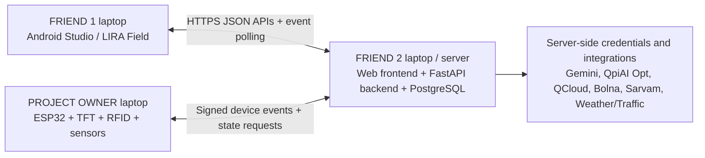

# LIRA — FRIEND 1: ANDROID APP BUILD INSTRUCTIONS FOR GOOGLE ANTIGRAVITY

> **Paste this entire file into Google Antigravity on Friend 1's laptop.** Build the actual Android Studio project, not just an explanation or design mock-up. This is the **Android application only**. Friend 2 owns the web dashboard **and** the central Python backend. The project owner builds ESP32/TFT hardware and contributes QpiAI solver code to Friend 2's backend repository.
>
> **Canonical contract:** This file and `LIRA_FRIEND_2_WEB_BACKEND_ANTIGRAVITY.md` use the same API paths and JSON data shapes. Do not rename paths, fields, states or enum values. If a necessary change is discovered, update the contract in BOTH projects before coding it.

## 0. Product and the exact job of this laptop

**Product:** LIRA — Logistics Intelligence & Recovery Automation. **Official track:** GENAI-01, Freight Exception Resolution Before Demurrage and Delivery Penalties.

**Problem:** A shipping container can get delayed by paperwork, customs holds, weather, traffic, port constraints, unavailable trucks, missed appointments or a physical no-show. Poor communication can create unnecessary charges and deliveries that miss deadlines.

**LIRA's flow:** Shipping documents/events -> grounded AI identifies a blocker -> checks risk and external disruptions -> calling agent obtains missing driver facts -> QpiAI QCloud explores a small conflict and QpiAI Opt validates/optimizes the overall truck/container/slot plan -> dispatcher approves -> driver app receives a job -> ESP32 checkpoint records physical staging -> if it fails, a **new recovery cycle** starts.

### Friend 1 owns

- A polished Android app called **LIRA Field** using **Kotlin, Jetpack Compose and Android Studio**.
- Screens for the truck driver and a small read-only inspector/checkpoint view.
- Driver's assigned jobs, time slots, countdowns, warnings, approved changes and reason-for-change.
- Acknowledgement (`ACKNOWLEDGE` or `CANNOT_COMPLY`) and self-reported ETA updates.
- External weather/traffic/port warnings **displayed from the backend**, not fetched with provider keys from Android. 
- Read-only physical status from the ESP32 through the backend (do not pretend the phone is the sensor).
- Offline cache/queued actions, reliable network reconnect and a demo mode.
- Tests, successful Gradle build, screenshots, and a README with setup instructions.

### Friend 1 does NOT own

- Gemini, QpiAI Opt, QpiAI QCloud, Bolna, Sarvam, provider API keys or credentials.
- Running the GenAI model, QAOA circuit, full optimization, cost engine or voice agent on Android.
- Manager approval (this belongs in the **web** dashboard).
- ESP32 firmware or actual container/customs-release authorization.

**Critical secret rule:** **No QpiAI/Gemini/Sarvam/Bolna/weather/traffic secret keys in the Android project.** Android only calls the authenticated LIRA backend. The Android project may include a **public backend URL** and hold a short-lived user session token securely; it must never contain server-side provider secrets.

## 1. Three-laptop architecture



**All three parts connect to Friend 2's backend.** `localhost` on Friend 1's laptop is NOT Friend 2's server. Use a reachable LAN IP for local testing, or an HTTPS deployment/tunnel for cross-network testing. Android emulator normally reaches a server on the *same machine* via `10.0.2.2`; this will NOT magically reach Friend 2's laptop. Coordinate the actual reachable backend URL.

## 2. Technology stack and project layout

- Kotlin + Jetpack Compose + Material 3.
- Android Studio Gradle project, application id `com.lira.field`.
- MVVM: ViewModel + state flows + repository + API service.
- Retrofit / OkHttp + Kotlinx Serialization (or Moshi, select one consistently).
- Kotlin Coroutines, Lifecycle ViewModel, Navigation Compose.
- Room for caching assigned jobs and queued driver actions; WorkManager for reliable upload after reconnection.
- DataStore for non-sensitive preferences; encrypted/Android Keystore-backed session storage where feasible.
- Unit tests for models, state changes and network/error mapping; Compose UI tests for critical screens.
- Min Android version: API 26, unless Android Studio dependencies require a higher minimum; use currently installed stable compatible versions.

Suggested package layout:

```text
lira-android/
  README.md
  settings.gradle.kts
  build.gradle.kts
  app/
    build.gradle.kts
    src/main/AndroidManifest.xml
    src/main/java/com/lira/field/
      MainActivity.kt
      LiraApp.kt
      core/network/{ApiService,AuthInterceptor,ApiError}.kt
      core/model/{Assignment,Disruption,Event,Checkpoint}.kt
      core/database/{LiraDatabase,AssignmentDao,PendingActionDao}.kt
      core/session/SessionRepository.kt
      data/{LiraRepository,SyncWorker}.kt
      ui/theme/
      ui/navigation/
      ui/login/
      ui/home/
      ui/assignments/
      ui/disruptions/
      ui/checkpoint/
      ui/activity/
      ui/settings/
    src/test/
    src/androidTest/
  docs/screenshots/
```

Store only the **backend base URL** in a build configuration / ignored `local.properties` file. Example development configuration:

```properties
# Android local.properties (not an API secret; not committed with personal paths)
LIRA_API_BASE_URL=http://192.168.1.50:8000/api/v1/
```

Use HTTPS in deployment. If local HTTP is unavoidable, allow cleartext only in the **debug** configuration, not release.

## 3. Design experience — make it look like a real industrial driver app

Visual direction: clean, dark navy + white + restrained cyan and amber accents; large touch targets and unambiguous words. Show severity using both color and text. Never use a tiny unreadable dashboard. Driver actions must take only a few taps.

**Screens, in this order:**

1. **Sign-in / Demo Role:** driver selector (`DRIVER_T04`, `DRIVER_T07`, `DRIVER_T09`) for `DEMO_AUTH_ENABLED=true` only. Explain this is a demonstration, not production authentication.
2. **My Today:** current approved assignment, container alias, truck, slot, checkpoint, deadline countdown, readiness, big `ACKNOWLEDGE` / `CANNOT COMPLY` buttons. If there is no assignment, show a useful empty state.
3. **Assignment Details:** previous vs new assignment, reason for change, evidence summary, required next action, deadline and whether dispatcher approval exists. Do **not** display raw shipping documents or another driver's private data.
4. **Update ETA:** choose reason (`TRAFFIC`, `WEATHER`, `BREAKDOWN`, `OTHER`); select ETA; submit to backend. Mark as a **driver report**, not authoritative GPS or terminal status.
5. **Risk Alerts:** backend-sent weather, traffic, port closures/holds with `FORECAST_RISK` versus `CONFIRMED_DISRUPTION`, time/source, affected slot, and 'what changed'. A forecast does not automatically mean a port is closed.
6. **Checkpoint Status:** expected truck/tag check-in, bay occupancy, and latest edge event from server. Clearly state `PHYSICAL STAGING NOT YET EVIDENCED` until the hardware logs the right signals.
7. **Activity Timeline:** `PLAN_APPROVED`, `DRIVER_ACKNOWLEDGED`, `ETA_UPDATED`, `PHYSICAL_MISMATCH`, `RECOVERY_STARTED`, `PLAN_REPLACED`, `STAGING_EVIDENCED`.
8. **Offline + Settings:** last sync, pending requests, reconnect button, logout, privacy notice. No sensitive details on a visible notification.

### Essential WOW interaction

When the manager approves a new QpiAI recommendation, the app instantly or within the polling interval displays:

```text
LIRA FIELD
REASSIGNED — PLAN R2
Container: C102
Previous: T04 @ 16:00
New:      T07 @ 16:00
Reason: T04 delayed 45 min
Status: APPROVED — AWAITING DRIVER ACK
[ACKNOWLEDGE] [CANNOT COMPLY]
```

If the checkpoint sends a physical no-show, the app must display a second update:

```text
PHYSICAL CHECK FAILED
Checkpoint event: NO_SHOW
Previous plan is no longer active.
New recovery is being calculated...
```

When the backend approves another feasible plan, render it **without manual app database editing**.

## 4. LOCKED API contract — use these routes exactly

**Base:** `https://<SERVER_HOST>/api/v1` (LAN HTTP only for debug). All responses use JSON. Timestamps are ISO 8601 with timezone, ideally UTC in storage and local display using Asia/Kolkata. Currency in responses is `projected_avoidable_cost_inr` (integer rupees for demo; backend is authoritative). IDs are opaque strings.

**Auth** (development only):

`POST /api/v1/auth/demo-login`

Request:

```json
{"user_code":"DRIVER_T07"}
```

Response:

```json
{"access_token":"EXAMPLE_SESSION_TOKEN","token_type":"bearer","expires_in":3600,"role":"DRIVER","display_name":"Driver T07","truck_id":"T07"}
```

Send `Authorization: Bearer <access_token>` after login. Backend enforces that a driver can only access their own records.

**Health:** `GET /api/v1/health` -> `{"status":"ok","mode":"DEMO","version":"v5"}`.

**Assignments:** `GET /api/v1/driver/assignments`

```json
{
  "items": [{
    "assignment_id": "ASN-102-R2",
    "plan_id": "PLAN-R2",
    "container_id": "C102",
    "truck_id": "T07",
    "slot_id": "S1600",
    "slot_start": "2026-10-28T16:00:00+05:30",
    "slot_end": "2026-10-28T16:30:00+05:30",
    "checkpoint_id": "LIRA-EDGE-01",
    "status": "APPROVED",
    "driver_ack_state": "PENDING",
    "physical_state": "EXPECTED",
    "reason_code": "T04_ETA_CONFLICT",
    "reason_text": "Original driver cannot reach the confirmed slot",
    "customs_release": "CONFIRMED",
    "deadline": "2026-10-28T18:30:00+05:30",
    "projected_avoidable_cost_inr": 12000,
    "evidence_ids": ["EV-DOC-102", "EV-CALL-04"],
    "updated_at": "2026-10-28T15:30:00+05:30"
  }],
  "updated_at": "2026-10-28T15:30:00+05:30"
}
```

Assignment `status`: `APPROVED | ACKNOWLEDGED | REASSIGNED | STAGING_EVIDENCED | PHYSICAL_NO_SHOW | CANCELLED`. `driver_ack_state`: `PENDING | ACKNOWLEDGED | CANNOT_COMPLY`. `physical_state`: `EXPECTED | RFID_MISMATCH | BAY_ABSENT_WARNING | PHYSICAL_NO_SHOW | STAGING_EVIDENCED`.

**Driver acknowledgement:** `POST /api/v1/driver/assignments/{assignment_id}/ack`

```json
{"action":"ACKNOWLEDGE","reason":null}
```

Or:

```json
{"action":"CANNOT_COMPLY","reason":"TRUCK_BREAKDOWN"}
```

Response: `{"accepted":true,"assignment_id":"ASN-102-R2","driver_ack_state":"ACKNOWLEDGED","event_id":"EVT-120"}` (state varies by action).

**ETA report:** `POST /api/v1/driver/eta`

```json
{"truck_id":"T07","eta":"2026-10-28T16:45:00+05:30","reason":"TRAFFIC","source":"DRIVER_SELF_REPORT"}
```

Response: `{"accepted":true,"event_id":"EVT-121","recovery_status":"QUEUED"}`. Backend checks that the authenticated driver owns this truck; never let the app send an arbitrary truck ID for another user.

**External disruptions:** `GET /api/v1/driver/disruptions`

```json
{
  "items": [{
    "event_id":"EXT-01", "type":"HEAVY_RAIN",
    "trust_state":"FORECAST_RISK", "severity":"HIGH",
    "title":"Heavy rain may delay the approach road",
    "source_label":"Weather feed / DEMO",
    "affected_trucks":["T07"],
    "starts_at":"2026-10-28T15:00:00+05:30",
    "ends_at":"2026-10-28T19:00:00+05:30",
    "updated_at":"2026-10-28T14:45:00+05:30"
  }]
}
```

`trust_state` is **only** `FORECAST_RISK | CONFIRMED_DISRUPTION | CANCELLED`. The Android app must distinguish these visually and in text. Never label a weather forecast as a confirmed port closure.

**Activity polling:** `GET /api/v1/driver/events?after=0`

```json
{
  "items":[{
    "event_id":"EVT-122",
    "sequence":122,
    "type":"PLAN_REPLACED",
    "assignment_id":"ASN-102-R2",
    "created_at":"2026-10-28T15:32:00+05:30",
    "payload":{"previous_plan_id":"PLAN-R1","new_plan_id":"PLAN-R2","reason":"PHYSICAL_NO_SHOW"}
  }],
  "next_sequence":122
}
```

**Checkpoint status:** `GET /api/v1/driver/checkpoint-status?assignment_id=ASN-102-R2`

```json
{
  "assignment_id":"ASN-102-R2",
  "device_id":"LIRA-EDGE-01",
  "state":"EXPECTED",
  "rfid_state":"NOT_SCANNED",
  "bay_present":false,
  "last_event_at":null
}
```

**Error format for all endpoints:**

```json
{"error":{"code":"VALIDATION_ERROR","message":"This assignment is no longer active","request_id":"REQ-101"}}
```

On `401`, prompt re-login; on `409`, refresh the assignment and explain that the plan changed; on `422`, show field validation; on network timeout, queue safe driver actions and retry with an idempotency key. Do not retry a user action endlessly or create duplicates.

## 5. Backend interaction rules

- Friend 2 implements the routes above. You can create **local fake JSON fixtures** under `app/src/debug/assets`, but the app must have a visible `DEMO MOCK DATA` indicator whenever they are displayed.
- Live mode must use actual backend responses. Never show `QpiAI run complete` or `call answered` unless the backend reports it.
- The app **does not** start Bolna/Sarvam calls directly: it shows results coming from the backend's authorized calling workflow.
- The app **does not** own weather and traffic API keys: backend collects and filters external alerts, then returns only relevant alerts to the driver.
- Do not allow app-side approval or editing of official customs release.
- Keep offline driver actions with stable local IDs and `Idempotency-Key` headers on retry; show `PENDING SYNC` until acknowledged.
- Poll `/driver/events` every 5 seconds while app is foregrounded and refresh assignments on any `PLAN_*`, `PHYSICAL_*` or `RECOVERY_*` event. Support optional WebSocket/SSE as a later improvement, but polling must work first.
- Use role-aware view models; display friendly error and empty states. Show when data was last refreshed.

## 6. Test cases (must run, not only describe)

1. `DRIVER_T07` logs in and sees only T07 assignments.
2. A newly approved plan appears from the backend without reinstalling the app.
3. Driver ACK updates on web via backend; double tap does not create two events.
4. `CANNOT_COMPLY` updates state and queues new recovery on backend.
5. Manual ETA update changes only the authenticated driver's truck.
6. Heavy-rain forecast displays **risk**, not confirmed closure.
7. Confirmed port closure event displays a different state and a real block after backend validation.
8. Wrong RFID / empty bay event appears as a checkpoint warning; app never calls it gate-out.
9. Physical no-show triggers `PLAN_REPLACED`; app receives the second plan.
10. Airplane mode: cached assignment remains readable, action is visibly queued, reconnect sends once.
11. No API keys or server secrets appear in APK/BuildConfig/Gradle sources.
12. Build success with `./gradlew assembleDebug`, plus unit tests and at least one Compose UI test.

## 7. Execution order for Antigravity

### Phase A — First, build the working shell

Create the Android Studio project and screen navigation. Add clean placeholder UI, models, API interface, repository and error handling. Make the app compile before adding advanced polish.

### Phase B — Wire the locked contract

Implement demo login, assignments, ACK, ETA and event polling. Add an **in-app backend connection test**. In the absence of Friend 2's server, run against a local mock server that returns the exact JSON above and visibly label mock mode.

### Phase C — Add the standout demo

Implement the `PLAN_APPROVED -> DRIVER_ACK -> PHYSICAL_MISMATCH -> RECOVERY_STARTED -> PLAN_REPLACED` experience. Make the second plan visibly replace the old one with the full reason.

### Phase D — Add resilience and final QA

Room cache, WorkManager retries, permission minimization, visual refinement, accessibility, test suite, screenshots and README.

**Important: Antigravity must execute build/test commands, fix errors and provide the final working project.** Do not stop after writing a plan, creating a few placeholder screens or generating fake screenshots.

## 8. Acceptance checklist / definition of done

- [ ] Real installable Android application (`assembleDebug` succeeds).
- [ ] Matches the locked `/api/v1` contract exactly.
- [ ] Secure client: zero shared provider API keys in Android.
- [ ] Approved assignment, reason, deadline, ETA and checkpoint status are visible.
- [ ] Driver can ACK/reject and report ETA; backend receives it.
- [ ] Weather/traffic/port events shown with forecast-vs-confirmed distinction.
- [ ] No-show / recovery wave 2 updates the app automatically.
- [ ] Offline/retry/cache demonstrably work.
- [ ] README documents setup, backend URL, sample requests and testing.
- [ ] Screenshots and test results are generated from the running app.

## 9. Message to send Friend 2

> My Android app consumes `/api/v1/auth/demo-login`, `/api/v1/driver/assignments`, `/api/v1/driver/assignments/{id}/ack`, `/api/v1/driver/eta`, `/api/v1/driver/disruptions`, `/api/v1/driver/events` and `/api/v1/driver/checkpoint-status`. Please implement exactly the JSON contracts in my Markdown file and expose an address reachable from Android. All QpiAI, Gemini, Bolna, Sarvam and weather/traffic secrets stay in your backend, not my Android project.

**End of Android build instructions.**
